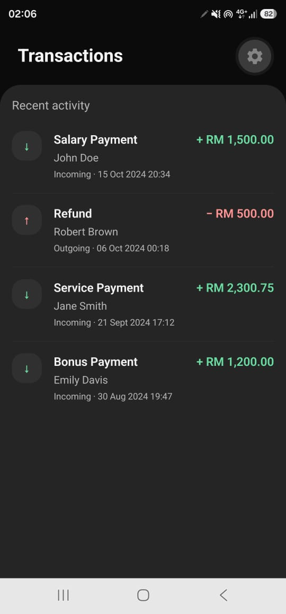
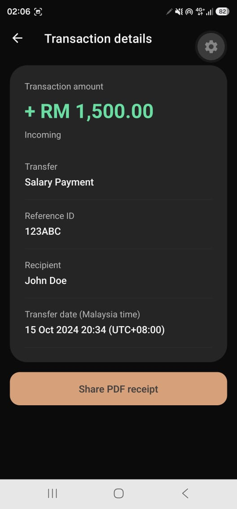
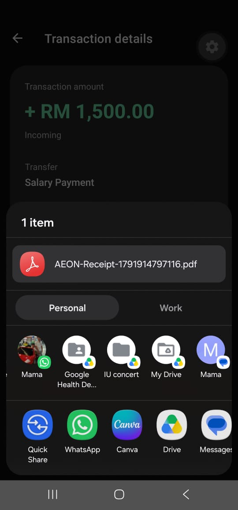
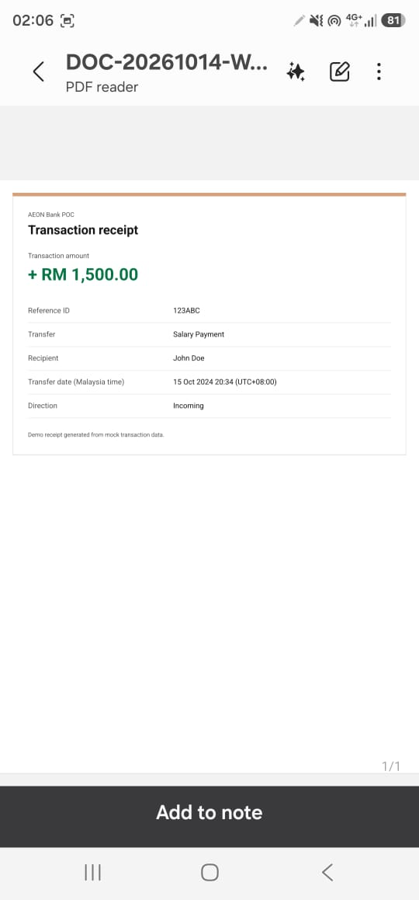

# AEON Bank Transaction POC

A React Native application built for the AEON Bank Mobile Engineer assessment using Expo, TypeScript, and Zustand. The project uses mock transaction data to demonstrate transaction history, receipt details, and PDF sharing with a simple interface and clear separation of responsibilities.

## App features

- Transaction history sorted from newest to oldest.
- Signed MYR amounts: incoming transactions appear in green and outgoing transactions in red.
- Transaction details with transfer name, reference ID, recipient, amount, and direction.
- Dates displayed in Malaysia time (`Asia/Kuala_Lumpur`, UTC+08:00).
- Pull-to-refresh, loading indicators, empty states, and retryable error states.
- Existing transactions remain available when a refresh fails.
- A single **Share PDF receipt** action that generates a receipt and opens the native share sheet.
- English UI translations managed centrally through i18next.
- Reusable components and a shared theme for consistent presentation.

## Screenshots

The screenshots below were captured on Android using mock transaction data.

| Transaction history | Transaction details |
| --- | --- |
|  |  |

| Native PDF share sheet | Exported PDF receipt |
| --- | --- |
|  |  |

## Tech stack

| Technology | Purpose |
| --- | --- |
| React Native | Native mobile screens and interactions |
| Expo | Development workflow and native module integration |
| TypeScript | Typed transaction models, repository contracts, and component props |
| Zustand | Transaction state, loading and error flags, and fetch actions |
| React Navigation / Native Stack | Navigation between transaction history and details |
| i18next / react-i18next | English translations and localization infrastructure |
| expo-print | Generate a PDF from a formatted HTML receipt |
| expo-file-system | Write PDF content into the app-scoped cache directory |
| expo-sharing | Share the generated PDF through the native share sheet |
| react-native-safe-area-context | Layout around device system insets |
| Jest / jest-expo | Unit tests with mocked native dependencies |

## Project structure

| Location | Responsibility |
| --- | --- |
| `src/api/` | Data-source access and mock responses |
| `src/components/` | Reusable rows, detail fields, buttons, and state messages |
| `src/i18n/` | i18next initialization and English translation resources |
| `src/navigation/` | Native stack and screen navigation |
| `src/repositories/` | Transaction repository interface and data-source implementations |
| `src/services/` | PDF generation, cached file creation, and native sharing |
| `src/store/` | Zustand store and transaction actions |
| `src/theme/` | Shared colors, spacing, typography, and corner radii |
| `src/types/` | Transaction, navigation, and translation types |
| `src/utils/` | Sorting, amount/date formatting, and receipt HTML formatting |
| `src/__tests__/` | Unit test suites and reusable test fixtures |

### Architecture

Screens compose reusable components and select the state they need from Zustand. The store fetches transactions through the `TransactionRepository` contract, sorts the results, and manages loading and error state. Replacing the mock data source with an API implementation can therefore happen at the repository boundary.

Utilities contain formatting and sorting functions that can be tested independently. The sorting utility accepts readonly input and returns a new array, preserving the original repository data.

The PDF service owns native printing, file-system access, and sharing. It requests PDF content as Base64, writes it into `FileSystem.cacheDirectory`, and shares that cached file. This keeps platform work out of screen layout code and uses the app-scoped file location for sharing.

## Setup and running

Use a Node.js version supported by the Expo SDK declared in `package.json`, npm, and an Android or iOS device with a compatible Expo Go installation. An emulator or simulator can also be used.

Clone this repository and run the following commands from the project root:

```bash
npm install
npx expo start
```

Open the project in Expo Go using the QR code. From the Expo terminal, press `a` for a configured Android emulator or `i` for an iOS simulator on macOS.

PDF file sharing targets Android and iOS. Test the native sharing flow on a device with a compatible receiving application installed.

## Tests and type checking

```bash
npm run typecheck
npm test
npm run test:ci
```

For watch mode:

```bash
npm run test:watch
```

The unit tests cover:

- Latest-first sorting and preservation of the input array.
- Signed MYR amounts and Malaysia time across a UTC date boundary.
- Successful, empty, failed, and overlapping transaction requests.
- Retaining existing data after a failed refresh and looking up transactions by reference ID.
- Sharing the PDF written into the app cache, unavailable sharing, missing PDF content, and file-write or native-sharing errors.

Store tests use injected test repositories. PDF tests mock printing, file-system, and sharing APIs, so the suites run without a device. Run type checking separately because the test runner transpiles TypeScript.

`test:ci` generates coverage reports for the configured sorting, formatting, store, and PDF service modules. Reports are written to `coverage/`; keep that generated directory out of version control.

## Demo walkthrough

1. Open the transaction history and confirm the newest transfer appears first.
2. Open an incoming and an outgoing transaction to inspect their details.
3. Pull down on the history list to refresh the transactions.
4. Tap **Share PDF receipt**, choose a compatible app, and open the PDF attachment.
5. Dismiss the share sheet and confirm the share button becomes available again.

## Current scope

The application uses mock data and English translations. Android screenshots demonstrate the receipt export and native share flow. iOS still needs device verification, and local PDF file sharing on web is outside the current scope.

The interface is intentionally focused on transaction history and receipt details, with a native stack between the two screens.

## Future improvements

- Connect a real API through the repository layer and validate its response schema.
- Add component interaction tests and end-to-end coverage for refresh and receipt sharing.
- Verify PDF generation and sharing on iOS devices.
- Introduce an expiry policy for cached receipt files.
- Add further locales using the existing translation infrastructure.
- Run type checking and tests in CI and provide review builds.
